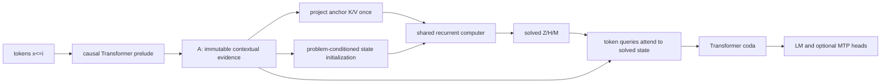

# IRL-3: a stateful latent recurrent computer

IRL-3 is an experimental causal language-model architecture in which shared
parameters describe a reusable neural program and recurrent time, workspace,
strategy, and writable memory are separate computational resources. It is not
a claim of superiority over a Transformer or IRL-2. The implementation is a
testable research hypothesis designed for pretraining and explicit test-time
compute experiments.

## 1. State and placement in the language model

The model has a fixed-depth Transformer prelude, one shared recurrent
computer, a latent-to-token write-back, and a short fixed-depth coda:



For causal prefix (i), recurrent step (t), and state width (d_s), the
joint state is

\[
S_i^{(t)} = \left(Z_i^{(t)}, H_i^{(t)}, M_i^{(t)}\right),
\]

where:

- (A_i) is immutable contextual evidence from the prelude;
- (Z_i\in\mathbb{R}^{N_Z\times d_s}) is a fast latent workspace;
- (H_i\in\mathbb{R}^{N_H\times d_s}) is a slower strategy state;
- (M_i\in\mathbb{R}^{N_M\times d_s}) is fixed-capacity writable memory;
- (E_i^{(t)}\in\mathbb{R}^{d_s}) describes phase, budget, and dynamics.

The main implementation is in
`lunaris_dense_irl3/irl3.py`. Ordinary attention, GQA, RMSNorm, SwiGLU,
RoPE, cache, initialization, and distributed infrastructure are shared with
the retained IRL-2 baseline.

## 2. Causal parallel-prefix execution

A sequential computer for every token would make teacher-forced pretraining
impractical. IRL-3 instead executes one independent small computer for every
causal prefix in parallel. State tensors therefore have shape

```text
[batch, prefix, slots, state_dim]
```

and state attention never mixes the `prefix` dimension. For prefix (i), the
anchor reader sees only positions

\[
\max(0, i-W_A+1)\le j\le i
\]

and respects padding and packed-document boundaries. The prelude is itself
causal. Consequently, changing a future token cannot change any earlier
state, write-back, or logit. Cached autoregressive decoding executes the same
program for only the newest prefix.

This design is intentionally a separation of **token time** from **reasoning
time**: token positions are parallel during pretraining, while recurrent depth
is the reusable program's internal clock.

## 3. Problem-conditioned initialization

Each state uses learned slot identities plus the current contextual token
representation:

\[
Z_i^{(0)} = \operatorname{RMSNorm}(W_Z A_i + Q_Z),
\]

\[
H_i^{(0)} = \operatorname{RMSNorm}(W_H A_i + Q_H),\qquad
M_i^{(0)} = \operatorname{RMSNorm}(W_M A_i + Q_M).
\]

Thus each prefix starts with a problem-conditioned workspace, strategy, and
memory rather than zeros. The immutable seeds are also injected through
learned prior projections during every recurrent step. This reduces the
failure mode in which a long loop forgets its input or learns to ignore its
incoming state.

## 4. Immutable anchor read

Anchor keys and values are computed once:

\[
K_A = W_K^A\operatorname{RMSNorm}(A),\qquad
V_A = W_V^A\operatorname{RMSNorm}(A).
\]

At every step, evolving latent queries ask a different question of the same
evidence:

\[
R_A^{(t)} =
\operatorname{Attention}(W_Q^A\operatorname{RMSNorm}(Z^{(t)}),K_A,V_A).
\]

QK normalization is applied per head. The bounded causal anchor window keeps
the recurrent read cost proportional to (L W_A), not (L^2). The anchor
states are already position-aware through the prelude and the trailing window
retains order; the latent anchor reader does not add a second RoPE rotation.

During cached generation, projected anchor K/V use a chronological ring
buffer and are appended once per token, not once per recurrent step.

## 5. Fast read and think transition

The workspace reads the anchor, memory, and strategy:

\[
R_M^{(t)}=\operatorname{Attn}(Z^{(t)},M^{(t)},M^{(t)}),\qquad
R_H^{(t)}=\operatorname{Attn}(Z^{(t)},H^{(t)},H^{(t)}).
\]

Let

\[
R^{(t)}=\operatorname{RMSNorm}\left(
R_A^{(t)}+R_M^{(t)}+R_H^{(t)}+E^{(t)}+P_Z Z^{(0)}
\right).
\]

A read gate controls integration rather than overwriting the workspace:

\[
\widetilde Z^{(t)} = Z^{(t)} +
\sigma\!\left(W_r[\operatorname{Norm}(Z^{(t)});R^{(t)}]\right)
\odot P_rR^{(t)}.
\]

Latent-to-latent communication and nonlinear computation form the proposal:

\[
U^{(t)}=\operatorname{SelfAttn}(\widetilde Z^{(t)}),
\]

\[
\Delta_Z^{(t)}=U^{(t)}+
\operatorname{SwiGLU}(\operatorname{Norm}(\widetilde Z^{(t)}+U^{(t)})).
\]

The update is feature-wise and state-conditioned:

\[
G_Z^{(t)}=\sigma\!\left(
W_g[\operatorname{Norm}(Z^{(t)});
\operatorname{Norm}(\Delta_Z^{(t)});E^{(t)}]
\right),
\]

\[
\widehat Z^{(t+1)}=
\operatorname{RMSNorm}(Z^{(t)}+s_Z\odot\Delta_Z^{(t)}),
\]

\[
Z^{(t+1)}=Z^{(t)}+G_Z^{(t)}\odot
(\widehat Z^{(t+1)}-Z^{(t)}).
\]

The model can preserve, partially revise, or replace each state feature. The
learned vector (s_Z) starts small, and the recurrent output projections are
scaled by inverse square root of the configured train depth.

## 6. Working-memory read and erase/add write

Memory is not concatenated passively. Memory slots query the new workspace:

\[
P_M^{(t)}=\operatorname{Attn}(M^{(t)},Z^{(t+1)},Z^{(t+1)}).
\]

The write controller also receives strategy, phase, and the immutable memory
prior:

\[
F_M^{(t)}=\operatorname{RMSNorm}\left(
M^{(t)}+P_M^{(t)}+\operatorname{mean}(H^{(t)})+E^{(t)}+P_M^0M^{(0)}
\right).
\]

It produces erase, add, and slot write gates:

\[
e^{(t)}=\sigma(W_eF_M^{(t)}),\quad
a^{(t)}=\tanh(W_aF_M^{(t)}),\quad
w^{(t)}=\sigma(W_wF_M^{(t)}),
\]

\[
\widehat M^{(t+1)}=
\operatorname{RMSNorm}((1-e^{(t)})\odot M^{(t)}+a^{(t)}),
\]

\[
M^{(t+1)}=M^{(t)}+w^{(t)}\odot
(\widehat M^{(t+1)}-M^{(t)}).
\]

This is fixed-capacity working memory. An expandable episodic store is not in
IRL-3 v1; adding it without a sparse access policy would undermine the
efficiency hypothesis.

## 7. Slow strategy clock

The slow state updates only every (k_H) recurrent steps. Between ticks it is
exactly preserved. On a tick, strategy slots read the joint fast and memory
state, communicate with each other, and apply a gated update:

\[
R_S^{(t)}=\operatorname{Attn}
(H^{(t)},[Z^{(t+1)};M^{(t+1)}],[Z^{(t+1)};M^{(t+1)}]),
\]

\[
\Delta_H^{(t)}=R_S^{(t)}+
\operatorname{SelfAttn}(H^{(t)}+R_S^{(t)})+
\operatorname{SwiGLU}(\cdot)+P_HH^{(0)},
\]

\[
H^{(t+1)}=H^{(t)}+G_H^{(t)}\odot
\left(\operatorname{RMSNorm}
(H^{(t)}+s_H\odot\Delta_H^{(t)})-H^{(t)}\right).
\]

This makes (H) a lower-frequency controller, not a renamed copy of (Z).
The phase encoder exposes the slow-clock position so the shared transition can
anticipate and use strategy updates.

## 8. Computational phase (E)

Exactly shared weights can learn an unproductive stationary loop. IRL-3 uses
a continuous phase controller rather than a lookup embedding for each depth.
Its 12 features include:

- normalized progress and remaining budget;
- absolute depth normalized by the maximum supported depth;
- logarithmic assigned budget;
- sine/cosine progress coordinates;
- slow-clock phase;
- previous (Z/H/M) update magnitudes;
- previous memory-read magnitude;
- current conditional survival probability.

A small MLP maps these features to (E^{(t)}). The same program can therefore
condition behavior on exploration, integration, strategy ticks, convergence,
and the requested test-time budget without allocating separate per-step
blocks.

## 9. Learned halting and explicit compute control

The halt head uses pooled joint state, phase, and residual:

\[
\lambda_i^{(t)}=\sigma\!\left(
W_2\operatorname{SiLU}(W_1[
\bar Z_i^{(t)};\bar H_i^{(t)};\bar M_i^{(t)};
E_i^{(t)};r_i^{(t)}])
\right).
\]

The hazard is forced to zero before `irl3_min_steps`. With survival

\[
q_i^{(t)}=\prod_{j<t}(1-\lambda_i^{(j)}),
\]

the halt mass is

\[
p_i^{(t)}=q_i^{(t)}\lambda_i^{(t)},
\]

and any remainder is assigned to the last allowed step. Training uses a
differentiable state-marginalized result

\[
\bar S_i=\sum_t p_i^{(t)}S_i^{(t)}
\]

plus a delayed ponder cost

\[
\mathcal L_{\mathrm{ponder}}=
\mathbb E_i\left[\sum_t t\,p_i^{(t)}\right].
\]

This borrows the conditional-hazard idea from PonderNet but is not its exact
expected-per-step prediction loss. The approximation avoids running the
Transformer coda and vocabulary projection at every recurrent step.

Three modes are implemented:

- `fixed`: run exactly the assigned budget; used for controlled scaling;
- `act`: soft halt distribution with a fixed maximum; used for training;
- `adaptive`: evaluation-only per-prefix hard freezing once cumulative mass
  reaches `irl3_halt_threshold`.

Adaptive halting is finer than one global batch decision. It can avoid later
state updates for completed prefixes, although dense parallel kernels may not
turn all inactive-prefix sparsity into proportional wall-clock savings.

An explicit `compute_depth` overrides the normal train/eval budget. If no halt
mode is supplied, explicit depth selects `fixed`, making comparisons
reproducible.

## 10. Equilibrium objective and credit assignment

IRL-3 treats the joint state as a dynamical system but does not require memory
to converge as strongly as reasoning state. The terminal objective is

\[
\mathcal L_{\mathrm{eq}}=
\frac{\|Z^{(T)}-Z^{(T-1)}\|_2^2}
{\|\bar Z\|_2^2+\epsilon}
+
\frac{\|H^{(T)}-H^{(T-1)}\|_2^2}
{\|\bar H\|_2^2+\epsilon}
+\eta_M
\frac{\|M^{(T)}-M^{(T-1)}\|_2^2}
{\|\bar M\|_2^2+\epsilon}.
\]

(eta_M<1) by default because useful memory may still be writing near the
terminal state. This is a diagnostic and weak regularizer, not an implicit
DEQ solver or a proof of contraction.

For deep recurrence, `gradient_horizon=K` runs the earliest (T-K) steps under
`torch.no_grad()` and backpropagates through the final (K). Immutable priors
and shared parameters are reinjected in every differentiable step, so the
transition still receives direct credit. The schedule warms both compute
depth and credit horizon. Full BPTT is obtained by setting (K=T).

Update RMS uses a zero-preserving stabilized norm. This is necessary because
(H) is exactly unchanged between clock ticks; the derivative of an
unstabilized square root at a zero residual can otherwise produce NaN
gradients despite finite forward activations.

## 11. Token write-back

The recurrent result is on the main logit path. Each token forms a query from
its anchor and attends to all final fast, slow, and memory slots:

\[
Q_i^W=W_Q^W\operatorname{RMSNorm}(A_i),\qquad
C_i=\operatorname{Attn}(Q_i^W,[\bar Z_i;\bar H_i;\bar M_i]),
\]

\[
\Delta A_i=s_W\odot W_OC_i\odot
\sigma(W_G[Q_i^W;C_i]),
\]

\[
A_i'=A_i+\Delta A_i.
\]

The coda and LM head consume (A_i'). The write-back scale starts small but
nonzero, so the recurrent computer affects logits from initialization while
preserving a stable residual route.

## 12. Persistent state across token time

`IRL3Cache` stores normal Transformer K/V, a separate anchor K/V ring, and an
optional public `IRL3State`. During cached generation, the final (Z/H/M) of
one token can seed the next token.

Persistent fusion reuses the recurrent prior projections that are trained on
every ordinary batch. For seed (s) and carried slot (c):

\[
g=\sigma(\cos(s,c)),\qquad
s'=s+g(Pc-s).
\]

It introduces no parameters used only in streaming mode, which keeps optimizer
checkpoints complete before a dedicated cross-chunk training curriculum
exists. Persistence is opt-in (`irl3_persist_state`) and detached when stored
in an inference cache. Direct state input remains differentiable, so future
chunked or environment training is not blocked by the API.

## 13. Training objective and curricula

The implemented total loss is

\[
\mathcal L = \mathcal L_{\mathrm{NTP}}
+\gamma\mathcal L_z
+\alpha(s)\mathcal L_{\mathrm{MTP}}
+\beta(s)\mathcal L_{\mathrm{ponder}}
+\delta(s)\mathcal L_{\mathrm{eq}}.
\]

The trainer independently schedules:

- maximum recurrent depth;
- synchronized fixed, uniform, or log-uniform sampled depth;
- differentiable gradient horizon;
- delayed ponder pressure to avoid a shallow-halting trap;
- equilibrium weight;
- MTP weight and active horizons.

Log-uniform depth sampling exposes one shared program to several budgets and
is deterministic from optimizer step, so all distributed ranks use the same
control flow. MTP predicts farther horizons from the solved token
representation and shares the LM head; it does not instantiate a second
recurrent computer.

## 14. Cost model

Let (L) be sequence length, (T) recurrent depth, (W_A) anchor window,
and (N_Z,N_H,N_M) slot counts. The dominant anchor score tensor scales as

\[
O(BLTN_ZW_Ad_s),
\]

while state attention scales with small slot products such as

\[
O(BLT(N_Z^2+N_ZN_M+N_ZN_H)d_s).
\]

Anchor K/V are projected once, and recurrent parameters do not grow with
(T). Activations do grow with teacher-forced prefix count and gradient
horizon. For that reason the MI300X profile uses six fast slots, six memory
slots, two slow slots, a 128-token anchor window, recurrent depth six, and a
four-step gradient horizon.

The supplied qualification profile contains **134,772,866 parameters** in the
current implementation. Always use preflight as the authoritative count for
the checked-out commit.

## 15. Diagnostics

Diagnostics are reductions and are disabled by default. When requested they
include:

- actual and expected step counts, halt probabilities, halt mass, and
  converged fraction;
- active latent fraction;
- anchor-read RMS and normalized attention entropy;
- memory read/write RMS and write-gate utilization;
- (Z/H/M) update RMS and state RMS;
- joint terminal residual and consecutive residual ratios;
- token write-back RMS.

The MI300X depth benchmark records these with loss, latency, throughput, and
peak HBM in JSON.

## 16. What was borrowed and what is IRL-3

Borrowed prior ideas:

- parameter sharing across recurrent depth and position-wise adaptive compute
  from the [Universal Transformer](https://arxiv.org/abs/1807.03819);
- a latent bottleneck and repeated input cross-attention from
  [Perceiver](https://arxiv.org/abs/2103.03206);
- joint-state equilibrium language and terminal residual diagnostics from
  [Deep Equilibrium Models](https://arxiv.org/abs/1909.01377);
- separate fast/slow timescales from
  [Hierarchical Reasoning Model](https://arxiv.org/abs/2506.21734) and
  [HRM-Text](https://arxiv.org/abs/2605.20613);
- anchored recurrent depth, randomized training depth, and test-time compute
  scaling lessons from
  [Scaling up Test-Time Compute with Latent Reasoning](https://arxiv.org/abs/2502.05171);
- depth/budget conditioning lessons from
  [Depth-Conditioned Looped Transformers for ASR](https://arxiv.org/abs/2606.04678);
- the importance of explicit memory and delayed halting pressure from
  [Universal Transformers Need Memory](https://arxiv.org/abs/2604.21999);
- conditional halt hazards from
  [PonderNet](https://arxiv.org/abs/2107.05407);
- differentiable erase/add working memory from
  [Neural Turing Machines](https://arxiv.org/abs/1410.5401);
- state carried across chunks as a long-context precedent from
  [Recurrent Memory Transformer](https://arxiv.org/abs/2207.06881).

The IRL-3 composition is the combination of a causal parallel-prefix latent
computer, immutable anchor K/V, distinct fast/slow/writable state, semantic
read-think-write transitions, continuous dynamics-conditioned phase, soft
state-marginalized halting, gated write-back on the primary LM path, and an
optional token-time state cache. No cited paper is reproduced wholesale.

## 17. Relationship to IRL-2

IRL-2 performs a separate anchored SwiGLU refinement inside every Transformer
block. Its recurrent state has token shape, starts at zero, uses a learned
global damping scalar, and supports only global evaluation halting.

IRL-3 instead has one central compact state machine, explicit (Z/H/M),
selective anchor reads, local state communication, writable memory, a slow
clock, per-prefix halting, and explicit write-back before a coda. IRL-2 remains
unchanged under `lunaris_dense_irl2` and has its original profiles and trainer,
which keeps baseline comparisons straightforward.

## 18. Known limitations and falsifiable questions

- MI300X/ROCm/BF16 execution is prepared but has not yet been run.
- Fixed working memory may be too small, while larger memory may dilute
  attention; the profile must measure this trade-off.
- The soft state mixture is cheaper than exact expected per-step prediction
  loss but may train a weaker halt policy.
- Per-prefix hard freezing does not guarantee proportional kernel speedups.
- Persistent state has a functional inference path but no default
  cross-document training curriculum.
- The terminal residual does not establish global contraction, and no implicit
  fixed-point solver is used.
- Parallel-prefix state makes training activation cost linear in sequence
  length but nontrivial in recurrent depth and anchor window.
- Additional test-time depth can improve, saturate, or degrade a short-trained
  checkpoint. The supplied sweep is designed to measure rather than assume
  the answer.
- There is no sparse expandable episodic memory, tool API, WorldForge adapter,
  or RL objective in this phase.

These uncertainties are the purpose of the qualification experiment, not
features to conceal behind architectural claims.
